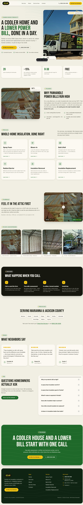

# A Plus Insulation — Website

Marketing and lead-generation site for **A Plus Insulation**, a family-run insulation
contractor in Marianna, Florida (Jackson County & the NW Florida Panhandle).

Built as a static site with **Astro + Tailwind CSS v4**. All customer-facing content
(copy, services, service area, SEO) lives in `src/data/site.ts`.

## Getting started

Requires **Node 20+**.

```bash
npm install      # install dependencies
npm run dev      # start the dev server at http://localhost:4321
```

Other commands:

```bash
npm run build    # build the static site to dist/
npm run preview  # preview the production build locally
```

## Pages

- **Home** — hero, trust points, process, cost table, FAQ
- **Services** — spray foam, blown-in, batt & roll, radiant barrier, removal, replacement
- **About** — the family, story, and commitments
- **Service Area** — interactive, real-geometry map of the counties served across FL, AL & GA
- **Contact** — free-estimate request

The service-area map geometry is projected from US Census county boundaries into
`src/data/panhandle-map.json`.

---

## Homepage



## Hosting

Served by **Cloudflare Workers Static Assets** at `https://insulation-demo.simsdigitalpartners.com`: config in
`wrangler.jsonc`, headers in `public/_headers`. There's no server: `dist/` is
uploaded as-is and served from Cloudflare's edge.

- **Deploy:** push to `main` → GitHub Actions (`.github/workflows/deploy.yml`)
  typechecks, builds and runs `wrangler deploy`, which also keeps the Custom
  Domain, its DNS record and certificate in place. PRs run the same checks plus
  `wrangler deploy --dry-run`, with no upload.
- **One-time setup:** repo secret `CLOUDFLARE_WORKERS_TOKEN` (API token with
  *Account · Workers Scripts: Edit* and *Zone simsdigitalpartners.com · Workers
  Routes: Edit*).
- **Not in search, on purpose:** this is a portfolio/demo site. Every response
  carries `X-Robots-Tag: noindex`, so it's only reachable from
  simsdigitalpartners.com or a direct link. Don't add `Disallow` to robots.txt;
  it would stop crawlers from reading the noindex.

**Old address:** this site used to be the Hostinger preview at `aplus.simsdigitalpartners.com`. That
hostname 301-redirects here through a Cloudflare **Redirect Rule** (dashboard →
simsdigitalpartners.com → Rules → Redirect Rules), so links already shared keep
working. Its DNS record must stay **proxied (orange cloud)** for the rule to fire.
Delete the rule and the record once the old links no longer matter.
